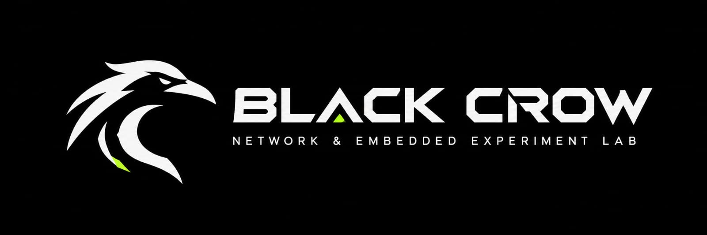
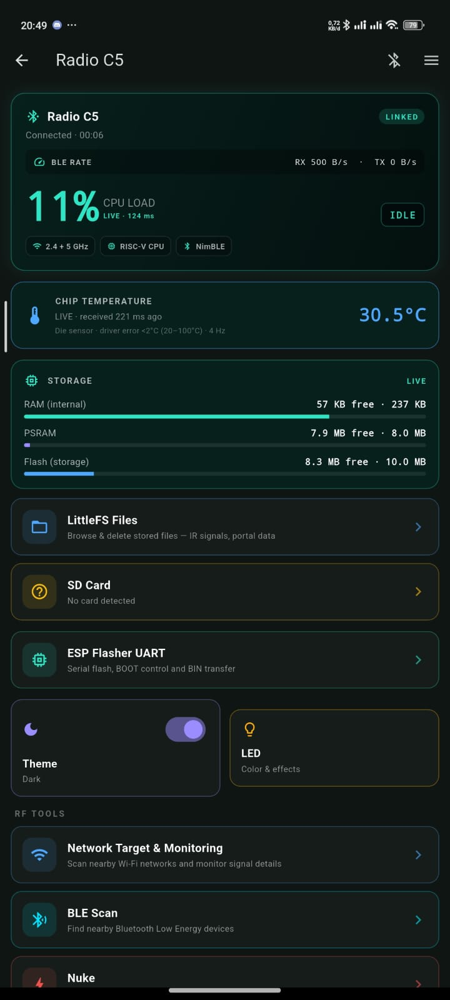
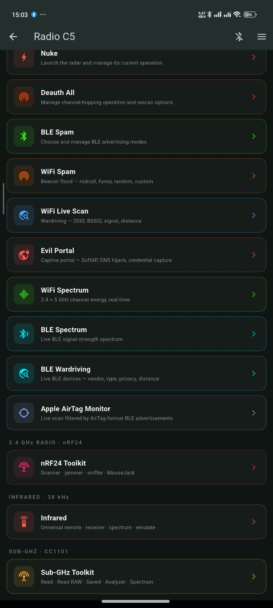

# Black Crow Firmware

This firmware is a fork of the original version of the x1watt/esp32 c5 deauth project, https://github.com/x1watt/esp32-c5-deauth, completely overhauling the original firmware. The original firmware only had features like WiFi scan, nuke, WiFi radar on nuke, 2.4GHz/5GHz WiFi attacks, and a few other features. In my first test with the original firmware, the WiFi attacks didn’t work and there were also issues with delay and freezing in the app. That’s when I tried to fix the WiFi attack problems and also address the app delay and freezing issues, completely revamp the firmware and app, and combine new features and improvements into the original components.

<p align="center">
  
</p>

# The primary focus of this project includes

Firmware Development — Developing and refining the core firmware to enhance stability and extensibility, while enabling support for various features and additional modules.

Wireless Control — Allowing the device to be fully controlled via a smartphone or desktop application, eliminating the need for an onboard TFT screen, physical buttons, or other local control interfaces.

BLE Communication — Utilizing Bluetooth Low Energy (BLE) with the NimBLE stack as the primary communication channel between the device and the control application.

Hardware Support — Integrating various modules—such as NRF24, CC1101, infrared (IR), and other supporting components—to expand the device's hardware experimentation capabilities.

Wi-Fi and Bluetooth Experimentation — Developing and testing 2.4 GHz Wi-Fi, 5 GHz Wi-Fi, and BLE features, based on the capabilities of the hardware in use, with a focus on learning, protocol analysis, compatibility testing, and experimentation within a safe and controlled environment.

# Reasons for Choosing Smartphone/Desktop-Based Control

Full control via BLE (Bluetooth Low Energy) was selected to enhance device efficiency and flexibility, based on the following considerations:
Cost Efficiency — Reduces production costs by eliminating the need for a TFT display and physical buttons.
More Flexible UI — Enables a more complex interface that is easier to develop and user-friendly.
Power Efficiency — Lowers power consumption by removing display components and physical control systems.
Practicality and Accessibility — Leverages smartphones or desktop computers that are already part of the user's daily routine.
Compact Design — Reduces the number of physical components and provides greater freedom in utilizing GPIO pins.

This approach results in a more compact, efficient, and flexible device without compromising ease of control.

# ESP32-C5 Multi-Radio Lab Toolkit

Firmware and companion controllers for the **ESP32-C5-DevKitC-1** with an
**ESP32-C5-WROOM-1-N16R8** module. The firmware is configured for 16 MB flash
and 8 MB quad-SPI PSRAM.

<p align="center">
  
  
</p>

<p align="center">
  <a href="https://vt.tiktok.com/ZSg4y3XAG/">Watch the video on TikTok</a>
</p>

This is a research and education project. Some firmware modules can transmit
radio signals or affect nearby devices. Use them only in an isolated lab, with
equipment and frequencies you are authorized to test. Do not use this project
to disrupt networks, collect credentials, track people, or interfere with
devices you do not own or have explicit permission to test. You are responsible
for complying with local laws and radio regulations.

## ⚠️  Ethical use only

This project is published for **defensive security research and
education** — penetration testing on networks you own or have explicit
written permission to assess, security training, capture-the-flag
exercises, lab demonstrations of Wi-Fi protocol weaknesses, and academic
study.

Using deauthentication frames against networks you do not own or do not
have explicit permission to test is **illegal in most jurisdictions**.
Examples that are NOT covered by this license:

- Interfering with a neighbor's, employer's, café's, school's, or
  airport's Wi-Fi
- Disrupting other people's video calls, smart-home devices, or IoT
  equipment
- Mass denial-of-service against arbitrary access points
- Bypassing captive portals or evading paid Wi-Fi access controls

If you would not be comfortable showing the network owner exactly what
you are doing, **do not run this firmware against that network**.

You are solely responsible for your use of this software. By building,
flashing, or running it you accept that responsibility.

---

## Project components

| Component | Directory | Purpose |
|---|---|---|
| ESP32-C5 firmware | [`esp32-c5/`](esp32-c5/) | ESP-IDF firmware, USB-Serial-JTAG console, BLE control, and optional radio/peripheral modules |
| Flutter controller | [`flutter/`](flutter/) | BLE controller app for Android and Linux desktop |
| Garmin watch app | [`garmin/`](garmin/) | Connect IQ companion for selected Fenix 7 watches |
| Unity test harness | [`unity-app/`](unity-app/) | ESP-IDF Unity test-project scaffold |
| Hardware reference | [`specs.md`](specs.md) | Official DevKitC-1 board details and J1/J3 pinout |
| Inspiration | [`inspirations/`](inspirations/) | Reference projects and research material |

The Flutter app and firmware communicate over BLE using the Nordic UART
Service (NUS). The firmware also exposes a USB-Serial-JTAG console. The BLE
device advertises as **Radio C5**.

## Firmware capabilities

The firmware includes:

- Wi-Fi discovery, dual-band targeted Wi-Fi attacks, mass Wi-Fi attacks on all reachable devices and channels with 2 modes, namely SKIP mode and UNICAST dual-band mode, real-time Wi-Fi monitoring, real-time Wi-Fi radar display, Wi-Fi monitoring, evil portal, Wi-Fi sniffer, and Wi-Fi spectrum display across all supported bands.  
- BLE device scanning, BLE spam, Apple AirTag monitoring, BLE wardriving, signal spectrum display, and passive observation tools.
- Support for nRF24L01+ radio modules, nRF sniffer scanning, spectrum scanner, nRF24 jammer supports two modes: automatic and manual, mousejack  
- Support for CC1101 module, signal reading, raw signal reading, emulation of saved signals, frequency analyzer, spectrum analyzer supports signal shifts from 315MHz-915MHz, supports preset OOK and FSK modulations, supports multiple protocols, and brute force  
- Support for infrared TX and RX, receiver functions, signal decoding, signal library, and infrared remote control, universal infrared remote  
- Support for internal storage Little FS and SD card, file/data transfer from Desktop/Phone
-ESP Flasher UART support, allows flashing by connecting the ESP32 Board UART pins to the hardware UART pins, transferring bin files from your phone/desktop to Little FS/SD card storage.  
-Device telemetry, including estimated internal temperature and CPU load, BLE speed, and built-in RGB status light.  
-Experimental radio transmission and captive-portal module. Use this feature only in a safe, isolated test environment; never request or store real user credentials.  

BLE observations are not proof of device identity or anyone's location. Signal strength is not an accurate measure of distance. Treat collected data as sensitive information and only keep what’s needed for official tests.

## Hardware

### Main board

- **Board:** Espressif ESP32-C5-DevKitC-1.
- **Module:** ESP32-C5-WROOM-1-N16R8 (16 MB flash, 8 MB quad-SPI PSRAM).
- **Onboard RGB LED:** GPIO27.
- **USB:** USB Type-C ports for power, serial/JTAG, and development.

See [`specs.md`](specs.md) for the official header pin map, power notes, and
strapping-pin cautions. Verify the module marking and board revision before
connecting external hardware.

### Optional peripherals

These are the firmware's current default signal pins; they are not included
with the DevKitC-1 board.

| Peripheral | Firmware pin assignment |
|---|---|
| Shared SPI bus | SCK GPIO6, MISO GPIO2, MOSI GPIO7 |
| microSD | CS GPIO1, card detect GPIO0 |
| nRF24L01+ | CSN GPIO9, CE GPIO8; uses the shared SPI bus |
| CC1101 | CS GPIO23, GDO0 GPIO24; uses the shared SPI bus |
| IR interface | TX GPIO4, RX GPIO5 |

The SD card and radio modules share SPI resources. The firmware initializes
the SD interface before enabling access to the SPI radios. Check voltage
levels, module wiring, and board pin constraints before powering a custom
setup; GPIO2 and several other ESP32-C5 pins have boot-strapping functions.

## Build and test

### ESP32-C5 firmware

Use the Espressif IoT Development Framework (ESP-IDF) environment. The
dependency lockfile in [`esp32-c5/`](esp32-c5/) records ESP-IDF **v5.5.1** and
the project targets `esp32c5`.

```sh
cd esp32-c5
idf.py set-target esp32c5
idf.py build
```

The custom partition table reserves `0x5F0000` bytes (about 5.94 MiB) for the
factory application and `0xA00000` bytes (10 MiB) for LittleFS. The
configuration and partition layout are for the N16R8 memory variant; do not
assume they fit a different board or module.

Building does not validate optional hardware or radio behavior. Perform
hardware tests only in a controlled, authorized lab.

### Flutter controller

Install Flutter with Dart SDK **3.10 or later**, then run from `flutter/`:

```sh
flutter pub get
flutter analyze
flutter test
flutter build apk --release
```

The app requests Bluetooth permissions as required by Android. Older Android
versions may also require Location permission and the Location service for BLE
scanning. The firmware must be powered on and advertising for the controller
to discover it.

### Garmin watch app

The Connect IQ app targets Fenix 7, Fenix 7 Pro, and Fenix 7X Pro products.
Building and sideloading require the Garmin Connect IQ SDK and a developer
signing key. Device-specific helper scripts are in [`garmin/`](garmin/).

## Repository layout

```text
.
├── esp32-c5/       ESP-IDF firmware and optional radio modules
├── flutter/        Android and Linux BLE controller
├── garmin/         Connect IQ watch companion
├── unity-app/      ESP-IDF Unity test-project scaffold
├── inspirations/   Reference projects
├── screenshots/    Controller screenshots and demos
├── specs.md        ESP32-C5-DevKitC-1 hardware reference
├── LICENSE         Apache License 2.0
└── NOTICE          Third-party attribution
```

## Credits and License

The foundation of this project started from [AnvilBrain/esp32-c5-dualband-deauther](https://github.com/AnvilBrain/esp32-c5-dualband-deauther).
This project also ports features from the Unleashed Flipper Zero Firmware (https://github.com/DarkFlippers/unleashed-firmware) such as the universal infrared remote and features like subGHz along with its protocols that were ported to work on the ESP32-C5 with ESP-IDF 5.5.1, Further development details are noted in [`NOTICE`](NOTICE).

## Contributions

This project is open source. You can help develop it by sending a Pull Request (PR). If you find any bugs or issues, please report them in the Issues section. Every contribution is highly appreciated.

## Support

If you like this project, follow and support me on TikTok: [@idextfury](https://www.tiktok.com/@idextfury). Thanks!

## License

This project is distributed under the **Apache License 2.0**. See [`LICENSE`](LICENSE) and [`NOTICE`](NOTICE) for license terms and attribution.
