## Black Crow Firmware (BCFW) — ESP32-C5

**BCFW**, short for **Black Crow Firmware**, is built for security projects — no USB cable needed, no TFT screen or buttons required. Only have a bare ESP32-C5 board with no extra peripherals wired up? No problem — the firmware connects to the companion app via BLE (NimBLE), which is quick to pair, so you can start using it right after flashing and installing the app.

<p align="center">
  
</p>

<p align="center">
  <a href="https://dextelktro.github.io/Black-Crow-ESP32-C5-Firmware/"><b>🔥 Flash your board straight from the browser — open the Black Crow Web Flasher</b></a>
</p>

> **Web Flasher — https://dextelktro.github.io/Black-Crow-ESP32-C5-Firmware/**
> Install the firmware straight from **Chrome** or **Edge** on desktop, with no
> toolchain and no command line. Pick your board (**ESP32‑C5‑DevKitC‑1** or
> **Seeed XIAO ESP32‑C5**), select the USB port, then **Erase** / **Start Flash**
> and open a built‑in **serial monitor** — then join the Discord.
>
> **(ID)** Flash firmware langsung dari browser (Chrome/Edge), tanpa toolchain.
> Pilih board, pilih port USB, lalu **Erase** / **Start Flash** dan buka **serial
> monitor** bawaan.

## Overview

**Black Crow Firmware (BCFW)** and its companion controllers target the **ESP32-C5-DevKitC-1** with an
**ESP32-C5-WROOM-1-N16R8** module. The firmware is configured for 16 MB flash
and 8 MB quad-SPI PSRAM.

<h3 align="center">Companion app — screenshot tour</h3>

<div align="center">
<table>
  <tr>
    <td align="center" width="235">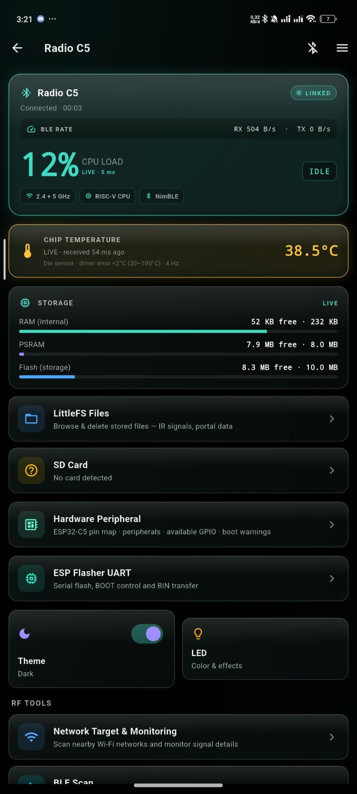<br><sub><b>Home dashboard</b><br>Link · CPU · temp · storage</sub></td>
    <td align="center" width="235">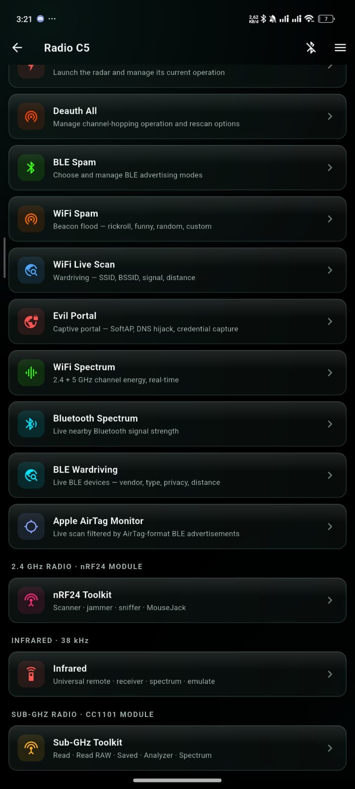<br><sub><b>RF tools menu</b><br>Every radio feature</sub></td>
    <td align="center" width="235">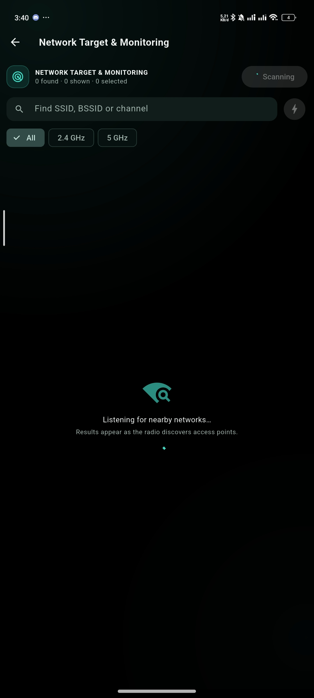<br><sub><b>Network Target</b><br>2.4 + 5 GHz live scan</sub></td>
  </tr>
  <tr>
    <td align="center">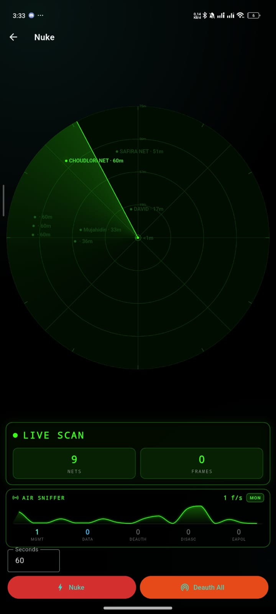<br><sub><b>Nuke radar</b><br>Live scan + air sniffer</sub></td>
    <td align="center">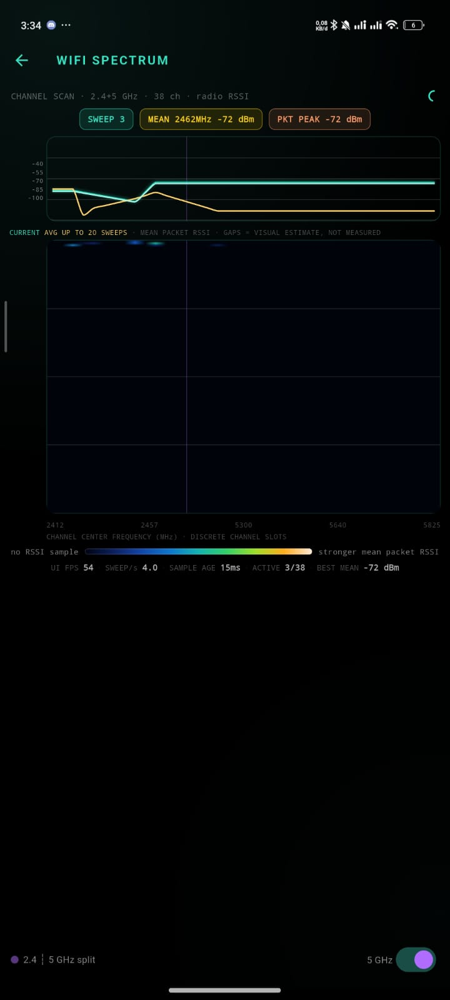<br><sub><b>WiFi spectrum</b><br>2.4 + 5 GHz waterfall</sub></td>
    <td align="center">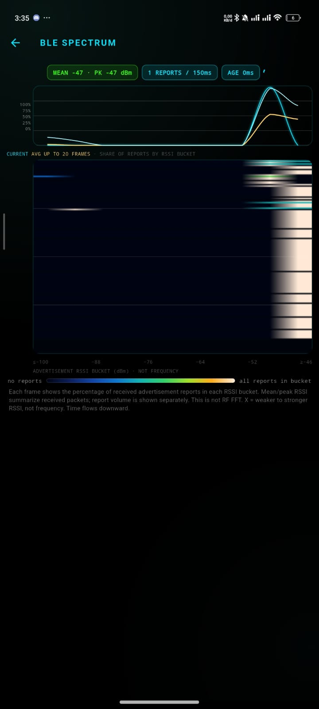<br><sub><b>BLE spectrum</b><br>Advertisement RSSI</sub></td>
  </tr>
  <tr>
    <td align="center">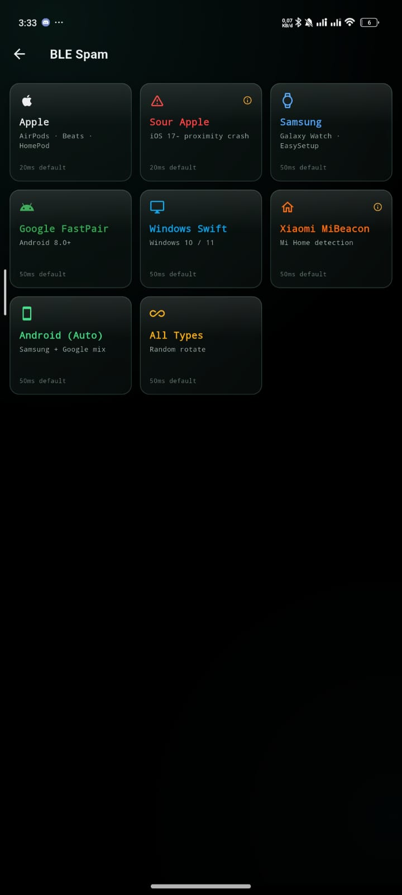<br><sub><b>BLE spam</b><br>Apple · Samsung · Google…</sub></td>
    <td align="center">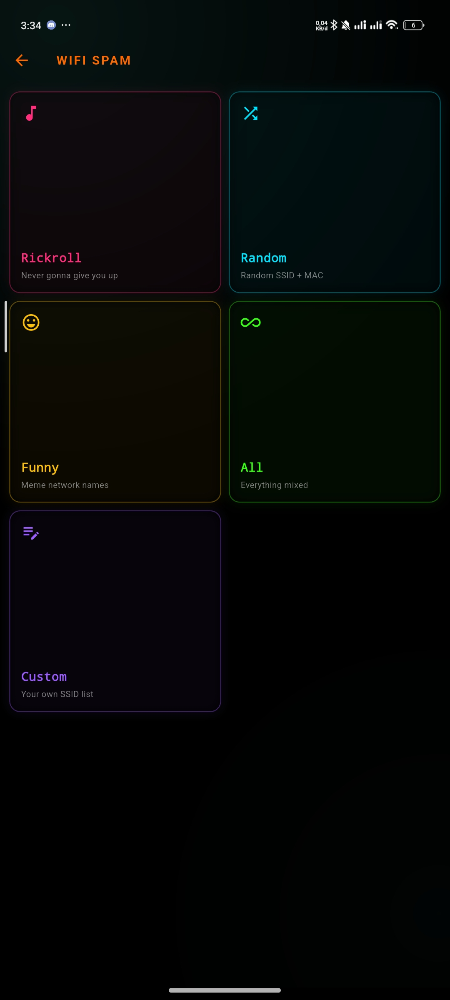<br><sub><b>WiFi spam</b><br>Rickroll · funny · custom</sub></td>
    <td align="center">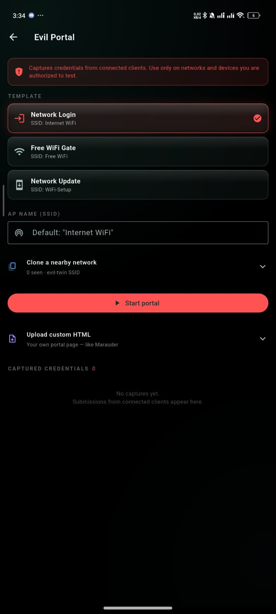<br><sub><b>Evil portal</b><br>Captive-portal templates</sub></td>
  </tr>
  <tr>
    <td align="center">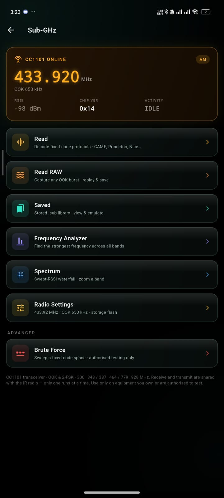<br><sub><b>Sub-GHz toolkit</b><br>Read · RAW · analyzer</sub></td>
    <td align="center">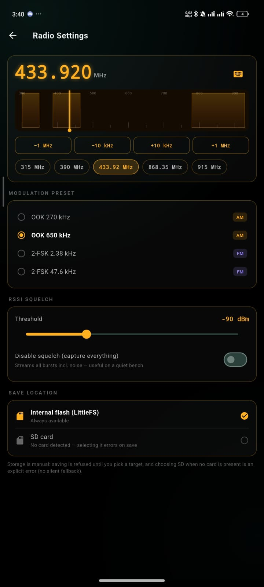<br><sub><b>Sub-GHz radio</b><br>Freq · preset · squelch</sub></td>
    <td align="center">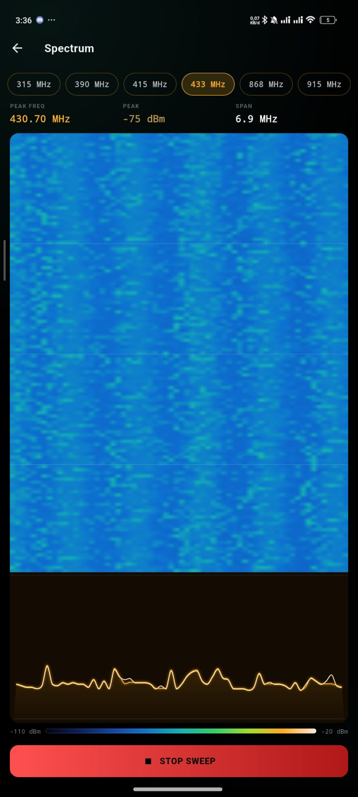<br><sub><b>Sub-GHz spectrum</b><br>Swept-RSSI waterfall</sub></td>
  </tr>
  <tr>
    <td align="center">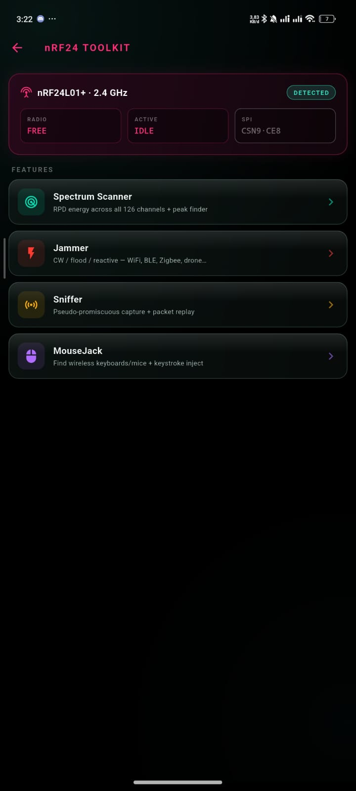<br><sub><b>nRF24 toolkit</b><br>Scan · jam · MouseJack</sub></td>
    <td align="center">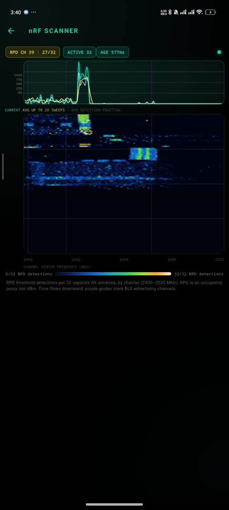<br><sub><b>nRF24 scanner</b><br>126-channel RPD map</sub></td>
    <td align="center">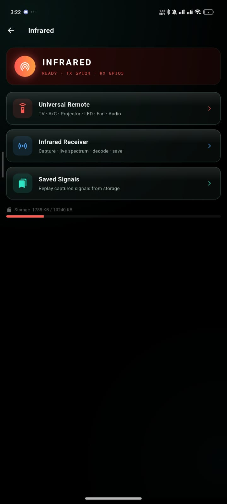<br><sub><b>Infrared hub</b><br>Remote · RX · saved</sub></td>
  </tr>
  <tr>
    <td align="center">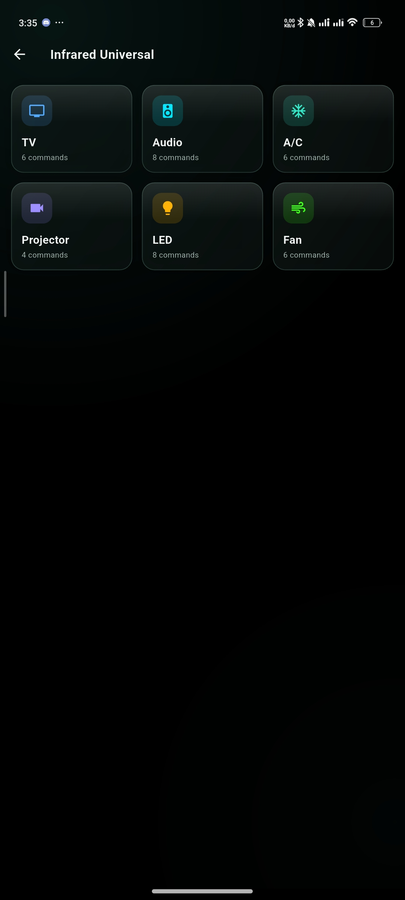<br><sub><b>Universal remote</b><br>TV · A/C · audio · more</sub></td>
    <td align="center">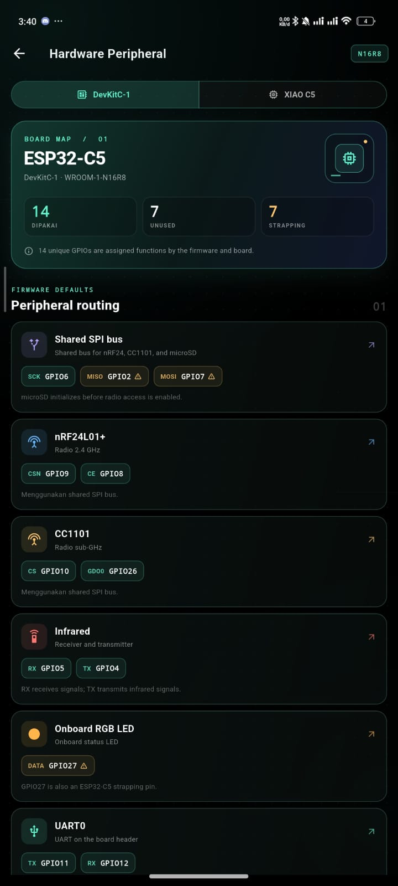<br><sub><b>Peripheral map</b><br>DevKitC-1 · XIAO</sub></td>
    <td align="center">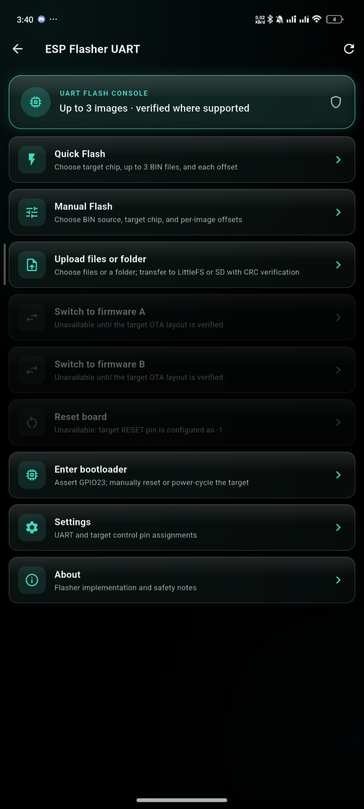<br><sub><b>ESP flasher</b><br>UART flash · upload</sub></td>
  </tr>
</table>
</div>

<p align="center">
  <a href="https://vt.tiktok.com/ZSg4y3XAG/">Watch the video on TikTok</a>
</p>

## Project components

| Component | Directory | Purpose |
|---|---|---|
| ESP32-C5 firmware | [`esp32-c5/`](esp32-c5/) | ESP-IDF firmware, USB-Serial-JTAG console, BLE control, and optional radio/peripheral modules |
| Flutter controller | [`flutter/`](flutter/) | BLE controller app for Android and Linux desktop |
| Garmin watch app | [`garmin/`](garmin/) | Connect IQ companion for selected Fenix 7 watches |
| Unity test harness | [`unity-app/`](unity-app/) | ESP-IDF Unity test-project scaffold |
| Hardware reference | [`specs.md`](specs.md) | Official DevKitC-1 board details and J1/J3 pinout |
| Inspiration | [`inspirations/`](inspirations/) | Reference projects and research material |

The Flutter app and firmware communicate over BLE using the Nordic UART
Service (NUS). The firmware also exposes a USB-Serial-JTAG console. The BLE
device advertises as **Radio C5**.

## Hardware

### Main board

This firmware supports the ESP32-C5-DevKitC-1 (N16R8, 16 MB) and the Seeed Studio XIAO ESP32-C5 (8 MB) from one code base; other RAM variants may be added in the future.

- **Board:** Espressif ESP32-C5-DevKitC-1.
- **Module:** ESP32-C5-WROOM-1-N16R8 (16 MB flash, 8 MB quad-SPI PSRAM).
- **Onboard RGB LED:** GPIO27.
- **USB:** USB Type-C ports for power, serial/JTAG, and development.

See [`specs.md`](specs.md) for the official header pin map, power notes, and
strapping-pin cautions. Verify the module marking and board revision before
connecting external hardware.

### Optional peripherals

These are the firmware's current default signal pins; they are not included
with the DevKitC-1 board.

| Peripheral | Firmware pin assignment |
|---|---|
| Shared SPI bus | SCK GPIO6, MISO GPIO2, MOSI GPIO7 |
| microSD | CS GPIO1, card detect GPIO0 |
| nRF24L01+ | CSN GPIO9, CE GPIO8; uses the shared SPI bus |
| CC1101 | CS GPIO23, GDO0 GPIO24; uses the shared SPI bus |
| IR interface | TX GPIO4, RX GPIO5 |

The SD card and radio modules share SPI resources. The firmware initializes
the SD interface before enabling access to the SPI radios. Check voltage
levels, module wiring, and board pin constraints before powering a custom
setup; GPIO2 and several other ESP32-C5 pins have boot-strapping functions.

## Build and test

### ESP32-C5 firmware

Use the Espressif IoT Development Framework (ESP-IDF) environment. The
dependency lockfile in [`esp32-c5/`](esp32-c5/) records ESP-IDF **v5.5.1** and
the project targets `esp32c5`.

```sh
cd esp32-c5
idf.py set-target esp32c5
idf.py build
```

```powershell
# Windows PowerShell — if idf.py isn't on PATH, source your ESP-IDF environment first
# (adjust the path below to wherever you installed ESP-IDF)
. "$HOME\esp\esp-idf\export.ps1"

Set-Location ".\esp32-c5"
idf.py set-target esp32c5
idf.py reconfigure
idf.py build
```

The custom partition table reserves `0x5F0000` bytes (about 5.94 MiB) for the
factory application and `0xA00000` bytes (10 MiB) for LittleFS. The
configuration and partition layout are for the N16R8 memory variant; do not
assume they fit a different board or module.

#### Seeed XIAO ESP32-C5 (second board)

The firmware also builds for the **Seeed Studio XIAO ESP32-C5** (8 MB flash /
8 MB PSRAM) from the same code base. The board pin map and feature flags live in
[`esp32-c5/main/board_config.h`](esp32-c5/main/board_config.h), selected by a
Kconfig choice.

| Function | XIAO pin |
|---|---|
| Shared SPI (SCK/MISO/MOSI) | GPIO8 / GPIO9 / GPIO10 (D8/D9/D10 — native SPI pins, not bit-banged) |
| nRF24 (CSN/CE) | GPIO11 / GPIO12 |
| CC1101 (CS/GDO0) | GPIO23 / GPIO24 |
| IR (TX/RX) | GPIO1 / GPIO25 |
| SD card (CS/CD) | GPIO0 / GPIO7 |

The XIAO build uses a **separate build directory** and the overrides in
[`esp32-c5/sdkconfig.defaults.xiao`](esp32-c5/sdkconfig.defaults.xiao) (8 MB
flash size, `partitions.xiao.csv`, XIAO pin map), so it never changes the
default DevKit build.

```sh
cd esp32-c5
idf.py -B build.xiao \
  -D SDKCONFIG=build.xiao/sdkconfig \
  -D SDKCONFIG_DEFAULTS="sdkconfig.defaults;sdkconfig.defaults.xiao" \
  build
```

On Windows PowerShell, use backtick line-continuations (or put it on one line):

```powershell
Set-Location ".\esp32-c5"
idf.py -B build.xiao `
  -D SDKCONFIG=build.xiao/sdkconfig `
  -D SDKCONFIG_DEFAULTS="sdkconfig.defaults;sdkconfig.defaults.xiao" `
  build
```

The XIAO partition table (`partitions.xiao.csv`) reserves `0x380000` bytes
(3.5 MiB) for the factory app and `0x470000` bytes (~4.4 MiB) for LittleFS to
fit 8 MB flash. Flash it over USB-C with `idf.py -B build.xiao -p <PORT> flash`
(hold **BOOT**, tap **RESET**, release BOOT if it does not enter download mode).
The plain DevKit build (`idf.py build`, `build/`) is unchanged. See
[`esp32-c5/README.md`](esp32-c5/README.md#board-variants) for the full XIAO pin
map and board differences (single-colour PWM LED, no UART ESP-flasher).

Building does not validate optional hardware or firmware behavior. Perform
hardware tests only in a controlled, authorized lab.

### Flutter controller

Install Flutter with Dart SDK **3.10 or later**, then run from `flutter/`:

```sh
flutter pub get
flutter analyze
flutter test
flutter build apk --release
```

Android release builds require the permanent release keystore. See
[`flutter/README.md`](flutter/README.md#build-and-test) for local signing
configuration, GitHub Actions secrets, and the certificate fingerprint check.

The app requests Bluetooth permissions as required by Android. Older Android
versions may also require Location permission and the Location service for BLE
scanning. The firmware must be powered on and advertising for the controller
to discover it.

### Garmin watch app

The Connect IQ app targets Fenix 7, Fenix 7 Pro, and Fenix 7X Pro products.
Building and sideloading require the Garmin Connect IQ SDK and a developer
signing key. Device-specific helper scripts are in [`garmin/`](garmin/).

## Repository layout

```text
.
├── esp32-c5/       ESP-IDF firmware and optional radio modules
├── flutter/        Android and Linux BLE controller
├── garmin/         Connect IQ watch companion
├── unity-app/      ESP-IDF Unity test-project scaffold
├── inspirations/   Reference projects
├── screenshots/    Controller screenshots and demos
├── specs.md        ESP32-C5-DevKitC-1 hardware reference
├── LICENSE         GNU General Public License v3.0 (or later)
└── NOTICE          Third-party attribution + GPL section 7 exception
```

## Credits and License

The foundation of this project started from [AnvilBrain/esp32-c5-dualband-deauther](https://github.com/AnvilBrain/esp32-c5-dualband-deauther). Further development details are noted in [`NOTICE`](NOTICE).

Several radio features — the **Sub-GHz** CC1101 modulation presets and protocol
decoders, and the **universal infrared** remote libraries — were ported from the
GPL-3.0 **Flipper Zero Unleashed** firmware
([DarkFlippers/unleashed-firmware](https://github.com/DarkFlippers/unleashed-firmware)).
Because that upstream is GPL-3.0, the combined work here is licensed
GPL-3.0-or-later. Full per-component attribution is in [`NOTICE`](NOTICE).

## Contributing

This project is open source. Discussion and development happen on the community Discord, and if you find a bug, please report it in **Issues**. Every contribution is appreciated.

### PR Requirements

- **Explain the change** — in the PR description, state what was changed/fixed and the problem/goal behind it.
- **Must be tested before opening the PR**, and include the test results (board used, test steps, outcome).
- **Internal RAM efficiency is required.** After making changes, check RAM usage and include the results in the PR. RAM savings must not come at the cost of features, performance, or firmware stability.
- **AI-assisted or manual coding is fine**, either way. But make sure you fully understand and have reviewed the code — AI-generated code isn't always bug-free, so don't submit code you don't understand yourself.
- **Large changes must be separated** from other fixes (separate PRs), and tested more thoroughly to ensure compatibility and stability.
- All PRs will be carefully reviewed before being merged.

## Community & Support

[](https://discord.gg/7hfsUcDPN)

Join the [Discord server](https://discord.gg/7hfsUcDPN) to follow development updates, ask questions, report issues, or contribute to the project.

This project is also supported by the [**Flipper-Zero-ESP32-Port / Sor3nt**](https://github.com/Sor3nt/Flipper-Zero-ESP32-Port) community — thanks for the support and for welcoming this project into your Discord, and thanks to everyone who has contributed and supported this project along the way.

If you find this project useful, you can also support its development by:

- ⭐ Starring this repository.

## 🚧 Disclaimer
This application is intended solely for legal and authorized security testing purposes. Using this software for malicious or unauthorized activity is strictly prohibited. By downloading, installing, or using the apps and firmware, you agree to comply with all applicable laws and regulations.
The developer of this project is not responsible for any misuse of this software. Use at your own risk.

## License

This project is **free software** distributed under the **GNU General Public
License v3.0 or later (GPL-3.0-or-later)**. It incorporates Sub-GHz and infrared
components derived from the GPL-3.0-licensed
[Flipper Zero Unleashed firmware](https://github.com/DarkFlippers/unleashed-firmware),
which is why the combined work is licensed under the GPL.

See [`LICENSE`](LICENSE) for the full license text and [`NOTICE`](NOTICE) for
third-party attribution and for the GPL section 7 linking exception that covers
the proprietary Espressif ESP-IDF binary libraries (e.g. `libnet80211.a`).
